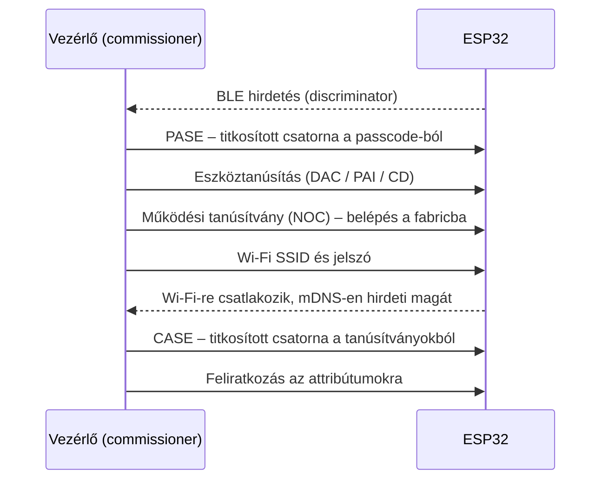
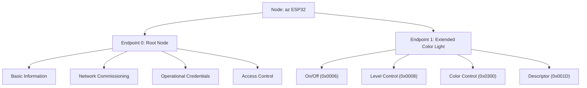

# Matter ismerkedés ESP32-vel és Home Assistanttal — 4 órás labor

Önálló tanulási terv a szakdolgozathoz (Moduláris okosotthon platform). A végére lesz egy saját fordítású Matter-eszközöd Home Assistantban, egy saját 5 csatornás LED-meghajtód és egy 4 relés, több endpointos eszközöd — mindhárom a specifikáció egy-egy moduljának előképe.

> **Állapot:** a parancsok az esp-matter `release/v1.5` ág dokumentációjából és forrásából származnak (2026. szeptember). Ezen a gépen még nem futottak le; ahol bizonytalanság van, jelölöm.

## Tartalom

- [Mit lehet és mit nem a klasszikus ESP32-vel](#mit-lehet-és-mit-nem-a-klasszikus-esp32-vel)
- [Ami kell hozzá](#ami-kell-hozzá)
- [Időterv](#időterv)
- [0. Előkészítés](#0-előkészítés-25-perc)
- [1. Gyors siker: kész firmware, párosítás](#1-gyors-siker-kész-firmware-párosítás-35-perc)
- [2. Fogalmak a működő eszközön](#2-fogalmak-a-működő-eszközön-35-perc)
- [3. Saját fordítás és kódolvasás](#3-saját-fordítás-és-kódolvasás-45-perc)
- [4. Saját 5 csatornás LED-meghajtó](#4-saját-5-csatornás-led-meghajtó-50-perc)
- [5. Négy relé, négy endpoint](#5-négy-relé-négy-endpoint-30-perc)
- [6. Összegzés](#6-összegzés-20-perc)
- [Ha elakad a telepítés](#ha-elakad-a-telepítés)
- [Továbblépés](#továbblépés)
- [Források](#források)

## Mit lehet és mit nem a klasszikus ESP32-vel

Az ESP32-WROOM-32U-ban Wi-Fi és Bluetooth LE van, 802.15.4 rádió nincs. Ezért ezen a lapon csak **Matter over Wi-Fi** megy; a párosítás (commissioning) Bluetooth LE-n indul.

| Átvihető az ESP32-C6-ra | Nem vihető át, a C6-tal kell megtanulni |
| --- | --- |
| Adatmodell: node → endpoint → cluster → attribútum / parancs | Thread-hálózat, Thread Border Router |
| Párosítás menete, fabric, több vezérlő egyszerre | Ethernet mint Matter-hálózati interfész |
| Az esp-matter API és a projektszerkezet | A Wi-Fi és a Thread közös rádión |
| Meghajtó illesztése az attribútum-visszahíváshoz | |

## Ami kell hozzá

- ESP32 fejlesztőlap (WROOM-32U) antennával, adatkábellel.
- Home Assistant ugyanazon a hálózaton, ahová az ESP32 csatlakozni fog (2,4 GHz-es Wi-Fi).
- Telefon a Home Assistant Companion alkalmazással, bekapcsolt Bluetooth-szal.
- Chrome vagy Chromium a gépen (az 1. blokk webes flashelőjéhez).
- Dugdosós panel, 1–5 LED, ugyanennyi 220–330 Ω ellenállás, néhány vezeték. LED nélkül is végigcsinálható, akkor a soros naplóból olvasod le az eredményt.
- ESP-IDF v5.5.x telepítve (`~/esp/esp-idf`).

## Időterv

| # | Blokk | Idő | Eredmény |
| --- | --- | --- | --- |
| 0 | Előkészítés | 0:00–0:25 | HA és telefon kész, a telepítés fut a háttérben |
| 1 | Gyors siker | 0:25–1:00 | Kész firmware-rel működő Matter-lámpa HA-ban |
| 2 | Fogalmak | 1:00–1:35 | Érted az adatmodellt, a fabricot és a párosítást |
| 3 | Saját fordítás | 1:35–2:20 | A saját buildet vezérled HA-ból |
| 4 | LED-meghajtó | 2:20–3:10 | RGB + hideg/meleg fehér, öt PWM-csatornán |
| 5 | Relék | 3:10–3:40 | Négy kapcsoló egy eszközön |
| 6 | Összegzés | 3:40–4:00 | Jegyzet és döntések a szakdolgozathoz |

A legnagyobb kockázat a 0. blokkban indított telepítés: a letöltés és az első fordítás együtt akár egy óra is lehet. Ezért fut a háttérben, amíg az 1–2. blokkot csinálod. Ha a 3. blokk elejére sem készül el, nézd meg a [Ha elakad a telepítés](#ha-elakad-a-telepítés) részt, és addig folytasd a 2. blokk feladatait.

> **Ha ESP32-S3 lapon csinálod:** arra nincs kész firmware, ezért az 1. blokk gyors sikere kimarad, és a sorrend más: 0 → 2.1 (elmélet, amíg a telepítés fut) → 3 → 1.3–1.4 → 2.2–2.4 → 4 → 5 → 6. A lábkiosztás is eltér; a 4. és 5. blokk táblázatában külön oszlop van rá.

---

## 0. Előkészítés (25 perc)

**Cél:** minden, ami várakozással jár, induljon el most.

### 0.1 Telepítés indítása a háttérben

Nyiss egy külön terminált, és hagyd futni. A PlatformIO saját Python-környezete elöl van a PATH-ban, és összeakad az ESP-IDF-fel, ezért ebből a terminálból ki kell venni.

```zsh
# PlatformIO kivétele a PATH-ból (csak erre a terminálra)
path=(${path:#*/.platformio/*})
export IDF_CCACHE_ENABLE=1          # gyorsabb újrafordítás; kell hozzá: sudo pacman -S ccache

. ~/esp/esp-idf/export.sh

cd ~/esp
git clone --depth 1 -b release/v1.5 https://github.com/espressif/esp-matter.git
cd esp-matter
git submodule update --init --depth 1
cd connectedhomeip/connectedhomeip
./scripts/checkout_submodules.py --platform esp32 linux --shallow
cd ../..
./install.sh --no-host-tool
```

- A `--no-host-tool` kihagyja a `chip-tool` fordítását. Így rövidebb, és kevesebb a hibalehetőség; a `chip-tool` a [Továbblépés](#továbblépés) része.
- A `release/v1.5` ág README-je az ESP-IDF **v5.5.5**-öt ajánlja. Ha v5.5.2-d van, először próbáld azzal, és csak fordítási hiba esetén frissíts.
- A Matter SDK rögzített Python-függőséglistáját 3.11-gyel generálták. Ha a rendszer Pythonja 3.14, nem biztos, hogy minden csomagból van hozzá való változat, és a `bootstrap.sh` elakadhat — erre van a [tartalék út](#ha-elakad-a-telepítés).

### 0.2 Home Assistant

- [ ] **Matter integráció:** Beállítások → Eszközök és szolgáltatások → Integráció hozzáadása → Matter.
  - *HA OS:* a felajánlott alapbeállítás telepíti a Matter Server alkalmazást (kiegészítőt).
  - *HA Container:* külön kell futtatnod a [Matter szervert](https://github.com/matter-js/matterjs-server/blob/main/docs/docker.md), és az integrációnak a `ws://<gép>:5580/ws` címet megadni. Ez hivatalosan nem támogatott út.
- [ ] **IPv6:** Beállítások → Rendszer → Hálózat → IPv6: *Automatikus*. IPv6-os internet nem kell, csak helyi IPv6.
- [ ] **Hálózat:** a HA és az ESP32 azonos VLAN-ban legyen; a multicast (mDNS) ne legyen szűrve az AP-n.

### 0.3 Telefon

- [ ] Companion alkalmazás frissítve, Bluetooth bekapcsolva, a telefon a 2,4 GHz-es hálózaton.
- [ ] **Android:**
  - Az alkalmazás helyhozzáférése legyen *Mindig engedélyezve*, különben a párosítás elakadhat.
  - A teszt-eszközt regisztrálni kell a [Google Home Developer Console](https://console.home.google.com/projects)-ban: új projekt → Matter integráció → Vendor ID `0xFFF1` (teszt), Product ID `0x8000`. Ugyanazzal a Google-fiókkal, amely a telefonon van. **Enélkül a párosítás Androidon meghiúsul.**
- [ ] **iPhone (iOS 16+):** nincs teendő; párosításkor „Nem tanúsított kiegészítő" figyelmeztetés jön, ott *Hozzáadás mindenképp*.

### 0.4 A lap ellenőrzése

Ha több soros eszköz van a gépen, húzd ki és dugd vissza a lapot, és nézd meg, melyik port tűnik el:

```zsh
ls /dev/ttyUSB*
export ESPPORT=/dev/ttyUSBx        # a lapod portja; az idf.py ezt használja
```

Az `ESPPORT`-ot minden új terminálban be kell állítani. Így a törlés és a flashelés biztosan nem másik lapra megy.

Ha a flashelő nem tud csatlakozni: tartsd nyomva a **BOOT** gombot, nyomd meg röviden az **EN**-t, majd engedd el a BOOT-ot. Sok klónlapon az automatikus letöltési mód nem megbízható.

**Kész, ha:** a telepítés fut, a HA-ban látszik a Matter integráció, a telefon elő van készítve.

---

## 1. Gyors siker: kész firmware, párosítás (35 perc)

**Cél:** működő Matter-eszköz HA-ban, még mielőtt a saját fordítókörnyezet elkészül.

### 1.1 Flashelés böngészőből

1. Nyisd meg Chrome-ban az [ESP Launchpad](https://espressif.github.io/esp-launchpad/?flashConfigURL=https://espressif.github.io/esp-matter/launchpad.toml)-ot.
2. *Connect* → válaszd ki a soros portot.
3. Válaszd a **`wifi_matter_light`** alkalmazást, és flasheld.

Ez az `examples/light` előre lefordított változata. Klasszikus ESP32-re, C3-ra és C6-ra van kép; ESP32-S3-ra nincs — azzal ugorj a 3. blokkra, és a párosítást ott végezd el.

### 1.2 Soros konzol

A Launchpad konzolja is jó, vagy PlatformIO-val:

```zsh
pio device monitor -p $ESPPORT -b 115200
```

A konzol interaktív. Kérd le a párosítókódot:

```
matter onboardingcodes ble
```

Az alapértelmezett teszt-értékek:

| | |
| --- | --- |
| QR-kód tartalma | `MT:Y.K9042C00KA0648G00` |
| Kézi párosítókód | `34970112332` |
| Passcode / discriminator | `20202021` / `3840` |

A QR-kód képként: <https://project-chip.github.io/connectedhomeip/qrcode.html?data=MT:Y.K9042C00KA0648G00>

### 1.3 Párosítás

A Companion alkalmazásban (nem böngészőben): Beállítások → *Connectivity* → Matter → *Eszköz hozzáadása* → *Nem, új eszköz* → QR-kód beolvasása. A magyar felületen a menü neve eltérhet. Régebbi HA-verzióban: Eszközök és szolgáltatások → *Eszköz hozzáadása* → *Matter-eszköz hozzáadása*.

Közben figyeld a soros naplót. A párosítás általános menete, egyetlen vezérlővel (így megy például `chip-tool`-lal):



Home Assistantnál ez a gyakorlatban két szakasz: a telefon (Androidon a Google, iPhone-on az Apple Matter-rétege) végzi a Bluetooth-os részt és a Wi-Fi-re léptetést, a HA Matter szervere pedig ezután, már IP-n csatlakoztatja az eszközt a saját fabricjához. A pontos lépések platformonként eltérnek; a naplóból követheted, nálad mi történik.

### 1.4 Kipróbálás

- Kapcsold HA-ból, állíts fényerőt. A GPIO5-re kötött LED (ellenállással a GND felé) követi; LED nélkül a napló mutatja az attribútum-változást.
- Nyomd meg a lap **BOOT** gombját: a lámpa átvált, és a HA-ban is frissül az állapot. Ez az eszköz → vezérlő irány.

**Kész, ha:** HA-ból kapcsolod a lámpát, és a gombnyomás megjelenik HA-ban.

**Ha nem megy:**
- *Android, „Matter nem érhető el" vagy azonnali hiba:* a 0.3 pont Developer Console lépése hiányzik.
- *Megáll a „Hálózati kapcsolat ellenőrzése" lépésnél:* IPv6 vagy mDNS gond, vagy a telefon más hálózaton van, mint a HA.
- *Újrapróbálás előtt:* a konzolon `matter esp factoryreset`.

**Szakdolgozat:** ez a Brain modul minimális változata — egy node, egy funkció.

---

## 2. Fogalmak a működő eszközön (35 perc)

**Cél:** az adatmodell és a fabric megértése úgy, hogy közben egy élő eszközt piszkálsz.

### 2.1 Az adatmodell



- **Node:** egy hálózati eszköz, egy fabricon belül egyedi node ID-val.
- **Endpoint:** egy logikai funkció. A 0. mindig az eszköz-szintű dolgoké.
- **Device type:** előírja, mely clustereknek kell lenniük egy endpointon (pl. Extended Color Light).
- **Cluster:** összetartozó attribútumok, parancsok és események csoportja.
- **Fabric:** egy vezérlő (pl. a HA) saját biztonsági tartománya. Egy eszköz egyszerre több fabric tagja lehet.

### 2.2 Feladatok az eszköz konzolján

```
matter config
matter esp attribute get 0x1 0x6 0x0        # On/Off állapot
matter esp attribute get 0x1 0x8 0x0        # fényerő (CurrentLevel, 0–254)
matter esp attribute get 0x1 0x300 0x7      # színhőmérséklet (mired)
matter esp attribute set 0x1 0x6 0x0 1      # bekapcsolás az eszköz felől
```

- [ ] Az utolsó parancs után nézd meg a HA-t: magától frissül. Miért? (Feliratkozás: az eszköz jelent, a HA nem kérdezget.)
- [ ] Mi a különbség az attribútum írása és egy parancs (pl. `Toggle`) között?

### 2.3 Feladatok a HA oldalán

- [ ] Nyisd meg a Matter Server felületét (HA OS-en az alkalmazás webes felülete). Keresd meg a node-ot, és járd végig: endpoint 0 és 1, azok clusterei, attribútumai.
- [ ] A Descriptor cluster `PartsList` és `DeviceTypeList` attribútumából a vezérlő innen tudja, mit lát. Keresd meg őket.
- [ ] **Próbálj színt és színhőmérsékletet állítani.** A klasszikus ESP32-höz tartozó LED-meghajtó (`device_hal/led_driver/gpio`) ezekre `ESP_ERR_NOT_SUPPORTED`-et ad vissza, és a visszahívás ezt továbbadja, így a várakozásom szerint a művelet hibát ad. Figyeld meg, mi történik a naplóban és HA-ban. Ezt javítod ki a 4. blokkban. (ESP32-S3-on a WS2812 meghajtó kezeli a színt, ott ez a hiba nem jön elő.)

### 2.4 Fabric-kísérlet

- [ ] HA-ban az eszköz lapján: *Eszköz megosztása*. Ez új párosítási ablakot nyit, gombnyomás nélkül. Ha van Google Home vagy Apple Home, add hozzá oda is, és nézd meg a *Fabricok kezelése* listát.
- [ ] Töröld az eszközt HA-ból. A naplóban megjelenik a fabric eltávolítása, és az eszköz párosítási ablakot nyit — de csak a hálózaton hirdeti magát (DNS-SD), Bluetoothon nem, hiszen a Wi-Fi adatai megmaradtak. Telefonos, Bluetooth-os újrapárosításhoz ezért gyári visszaállítás kell.
- [ ] `matter esp factoryreset` — vagy a BOOT gomb kb. 5 másodpercig nyomva, majd elengedve.

**Kész, ha:** saját szavaiddal el tudod mondani, mi a node, az endpoint, a cluster és a fabric, és mi történik párosításkor.

**Szakdolgozat:** a modulok (LED, Relé, Audió) nagy valószínűséggel endpointok lesznek egyetlen node-on. Ezt az 5. blokk után érdemes eldönteni.

---

## 3. Saját fordítás és kódolvasás (45 perc)

**Cél:** ugyanez az eszköz a saját forrásodból, a repódban.

### 3.1 Környezet minden új terminálban

```zsh
path=(${path:#*/.platformio/*})
export IDF_CCACHE_ENABLE=1
. ~/esp/esp-idf/export.sh
. ~/esp/esp-matter/export.sh
export ESPPORT=/dev/ttyUSBx        # a 0.4-ben azonosított port
```

### 3.2 Példa átmásolása a repóba

A példa minden külső útvonala az `ESP_MATTER_PATH` környezeti változón keresztül oldódik fel, ezért a mappa szabadon másolható.

```zsh
cd <a repód gyökere>
mkdir -p firmware
cp -r ~/esp/esp-matter/examples/light firmware/matter-light
cd firmware/matter-light
idf.py set-target esp32          # S3 lapon: esp32s3
idf.py build
```

A `.gitignore`-ba: `build/`, `sdkconfig`, `sdkconfig.old`, `managed_components/`, `dependencies.lock`.

Az első fordítás sokáig tart (több száz Matter-forrásfájl). Ezalatt olvasd a kódot (3.4).

### 3.3 Flashelés

Előtte töröld az eszközt HA-ból, ha még ott van — a flash törlése után a régi fabric-adatok elvesznek.

```zsh
idf.py erase-flash flash monitor     # kilépés: Ctrl+]
```

Az `erase-flash` csak első alkalommal kell. Utána párosítsd újra, mint az 1.3-ban.

> **ESP32-S3:** a beépített hardverleírás WS2812 LED-et vár a GPIO38-on. Sok S3 lapon a LED a GPIO48-on van, vagy nincs is; nézd meg a lapod feliratát.

### 3.4 Kódolvasás — `main/app_main.cpp`, `main/app_driver.cpp`

Keresd meg, és válaszolj:

- [ ] `node::create(...)` — melyik két visszahívást kapja meg?
- [ ] `extended_color_light::create(...)` — mit állít be a `config_t`? Mi a negyedik paraméter (`priv_data`), és hol kerül elő újra?
- [ ] `app_attribute_update_cb` — miért a `PRE_UPDATE` ágban hívja a meghajtót? Mi történik, ha hibát ad vissza?
- [ ] `app_driver_attribute_update` — hogyan jut el egy `(endpoint, cluster, attribútum, érték)` négyes a LED-ig?
- [ ] `app_driver_button_toggle_cb` — hogyan jelez az eszköz a vezérlő felé? (`attribute::update`)
- [ ] `esp_matter::start(app_event_cb)` — milyen eseményeket kap az `app_event_cb`?

### 3.5 Mini-módosítás

Az `app_attribute_update_cb` elejére tegyél naplózást, fordíts, flashelj:

```cpp
ESP_LOGI(TAG, "attr: type=%d ep=%u cluster=0x%04" PRIx32 " attr=0x%04" PRIx32,
         type, endpoint_id, cluster_id, attribute_id);
```

Állíts fényerőt HA-ból 2 másodperces átmenettel, és figyeld, hány visszahívás érkezik.

**Kész, ha:** a saját buildedet vezérled HA-ból, és a naplóban látod a saját sorodat.

**Szakdolgozat:** ez a projekt a Brain firmware kiindulópontja; C6-ra a `set-target esp32c6` és a megfelelő `sdkconfig.defaults.*` fájl viszi át.

---

## 4. Saját 5 csatornás LED-meghajtó (50 perc)

**Cél:** a LED-modul (R, G, B, hideg fehér, meleg fehér) viselkedése öt PWM-csatornán. A végleges hardveren I2C PWM-meghajtó lesz; itt az ESP32 saját LEDC perifériája helyettesíti.

### 4.1 Bekötés

| Csatorna | ESP32 | ESP32-S3 |
| --- | --- | --- |
| R | 25 | 4 |
| G | 26 | 5 |
| B | 27 | 6 |
| Hideg fehér (CW) | 32 | 7 |
| Meleg fehér (WW) | 33 | 15 |

Mindegyik LED ellenállással a GND felé. Ezek a lábak nem strapping lábak, és kimenetként szabadon használhatók.

> **ESP32-S3-on tilos:** GPIO26–32 (a beépített flash és PSRAM busza — ha meghajtod, a lap lefagy), 19–20 (USB), 43–44 (soros konzol), 0/3/45/46 (strapping). LED nélkül a naplózott kitöltési tényezőkből dolgozol.

### 4.2 Váz — `main/rgbcw_driver.h`

Vázlat, nem fordítottam le; a `TODO` részek a feladat.

```c
#pragma once
#include <stdbool.h>
#include <stdint.h>
#include <esp_err.h>

#ifdef __cplusplus
extern "C" {
#endif

typedef enum { RGBCW_MODE_HS, RGBCW_MODE_XY, RGBCW_MODE_TEMP } rgbcw_mode_t;

typedef struct {
    bool power;
    uint8_t level;        // 0..254, LevelControl::CurrentLevel
    uint8_t hue;          // 0..254
    uint8_t saturation;   // 0..254
    uint16_t x, y;        // CIE xy
    uint16_t mireds;      // kb. 153 (6500 K) .. 500 (2000 K)
    rgbcw_mode_t mode;
} rgbcw_state_t;

esp_err_t rgbcw_init(void);
esp_err_t rgbcw_apply(const rgbcw_state_t *s);

#ifdef __cplusplus
}
#endif
```

### 4.3 Váz — `main/rgbcw_driver.c`

```c
#include <driver/ledc.h>
#include <esp_check.h>
#include <esp_log.h>
#include <color_format.h>      // hsv_to_rgb(), xy_to_rgb(), temp_to_hs()
#include "rgbcw_driver.h"

static const char *TAG = "rgbcw";
enum { CH_R, CH_G, CH_B, CH_CW, CH_WW, CH_COUNT };
static const int s_gpio[CH_COUNT] = { 25, 26, 27, 32, 33 };   // ESP32-S3-on: 4, 5, 6, 7, 15

esp_err_t rgbcw_init(void)
{
    ledc_timer_config_t timer = {
        .speed_mode = LEDC_LOW_SPEED_MODE,
        .duty_resolution = LEDC_TIMER_8_BIT,
        .timer_num = LEDC_TIMER_0,
        .freq_hz = 5000,
        .clk_cfg = LEDC_AUTO_CLK,
    };
    ESP_RETURN_ON_ERROR(ledc_timer_config(&timer), TAG, "timer");

    for (int ch = 0; ch < CH_COUNT; ch++) {
        ledc_channel_config_t cfg = {
            .gpio_num = s_gpio[ch],
            .speed_mode = LEDC_LOW_SPEED_MODE,
            .channel = ch,
            .timer_sel = LEDC_TIMER_0,
            .duty = 0,
        };
        ESP_RETURN_ON_ERROR(ledc_channel_config(&cfg), TAG, "channel %d", ch);
    }
    return ESP_OK;
}

esp_err_t rgbcw_apply(const rgbcw_state_t *s)
{
    uint8_t duty[CH_COUNT] = { 0 };

    if (s->power) {
        if (s->mode == RGBCW_MODE_TEMP) {
            // TODO: a mired értékből CW/WW arány, s->level-lel skálázva
        } else {
            // TODO: HS vagy XY -> RGB a color_format.h függvényeivel
        }
    }

    ESP_LOGI(TAG, "R=%u G=%u B=%u CW=%u WW=%u",
             duty[CH_R], duty[CH_G], duty[CH_B], duty[CH_CW], duty[CH_WW]);
    for (int ch = 0; ch < CH_COUNT; ch++) {
        ledc_set_duty(LEDC_LOW_SPEED_MODE, ch, duty[ch]);
        ledc_update_duty(LEDC_LOW_SPEED_MODE, ch);
    }
    return ESP_OK;
}
```

### 4.4 Illesztés az `app_driver.cpp`-be

- [ ] Vegyél fel egy statikus `rgbcw_state_t`-t. Az `app_driver_light_set_*` függvények a `led_driver_*` hívás helyett ennek egy mezőjét írják, majd meghívják az `rgbcw_apply()`-t.
- [ ] A módot az utoljára írt attribútumból vezesd le: `CurrentHue` / `CurrentSaturation` → HS, `CurrentX` / `CurrentY` → XY, `ColorTemperatureMireds` → TEMP.
- [ ] Az `app_driver_light_init()` az `rgbcw_init()`-et hívja. A régi `led_driver_init()` maradjon ki, különben a GPIO5-öt is lefoglalja.
- [ ] Az `app_driver_light_set_defaults()` a kezdőértékeket az attribútumokból olvassa ki — ezt is az új állapotstruktúrára kell átírni.
- [ ] Olvasd el a `device_hal/led_driver/utils/color_format.c`-t, hogy a segédfüggvények milyen értéktartományt várnak (a Matter 0–254-et használ, az átskálázó makrók az `app_priv.h`-ban vannak).

### 4.5 Tervezési kérdések

- [ ] Színhőmérséklet módban csak a két fehér világítson, vagy az RGB is segítsen? Mit jelent ez 10 A csúcsterhelésnél?
- [ ] Az emberi szem nem lineárisan érzékeli a fényerőt. Kell-e gamma-korrekció, és elég-e hozzá a 8 bites felbontás?
- [ ] Egy 2 másodperces átmenet sok apró attribútum-frissítést jelent. Bírja-e ezt egy I2C-s PWM-meghajtó a közös buszon?

**Kész, ha:** HA-ból a színválasztó az RGB-csatornákat, a színhőmérséklet-csúszka a CW/WW arányt mozgatja, és a 2.3-ban látott hiba megszűnt.

**Szakdolgozat:** az `rgbcw_apply()` a LED-modul meghajtójának magja. A végleges változatban csak az utolsó ciklus változik: LEDC helyett I2C-írás.

---

## 5. Négy relé, négy endpoint (30 perc)

**Cél:** több azonos funkció egy eszközön — a Relé-modul adatmodellje.

```zsh
cd <a repód gyökere>
cp -r ~/esp/esp-matter/examples/multiple_on_off_plugin_units firmware/matter-relay
cd firmware/matter-relay
idf.py set-target esp32          # S3 lapon: esp32s3
idf.py menuconfig
```

A *Plugin manager* menüben:

| Beállítás | ESP32 | ESP32-S3 |
| --- | --- | --- |
| Number of virtual plugs | 4 | 4 |
| Plug 1 | 18 | 4 |
| Plug 2 | 19 | 5 |
| Plug 3 | 21 | 6 |
| Plug 4 | 22 | 7 |

> **Figyelem:** az alapértékek között klasszikus ESP32-n strapping lábak vannak (GPIO2, 5 és a 4. kimeneten a **GPIO12**). A GPIO12-t ha induláskor magasra húzza egy relépanel, a lap nem bootol. Kerüld a GPIO6–11-et (flash) és a 34–39-et (csak bemenet) is. Az S3-ra a 4.1 tiltólistája érvényes.

```zsh
idf.py erase-flash flash monitor
```

Párosítsd újra (előtte töröld a lámpát HA-ból).

- [ ] HA-ban egy eszköz jelenik meg négy kapcsolóval. A Matter Server felületén nézd meg az endpoint 0 `PartsList`-jét.
- [ ] Az `app_main.cpp`-ben keresd meg a `create_plug()`-ot: endpointonként egy `on_off_plug_in_unit::create()`, és a `priv_data` hordozza, melyik GPIO tartozik hozzá.
- [ ] Hogyan találja meg a meghajtó az endpoint ID-ból a GPIO-t? (`get_gpio()`)

### Tervezési kérdések

- [ ] A Brain egy node legyen sok endpointtal (LED + 4 relé + mérés), vagy híd (Aggregator + Bridged Node), ahol minden modul külön „eszközként" látszik?
- [ ] Az endpointok fordítási időben rögzítettek legyenek, vagy induláskor az I2C-buszon talált modulok alapján jöjjenek létre?
- [ ] Mi legyen a relék állapota áramszünet után? (`StartUpOnOff` attribútum)

**Kész, ha:** négy független kapcsolót látsz HA-ban, és a megfelelő lábak kapcsolnak.

**Szakdolgozat:** ez a Relé-modul Matter-oldala. A GPIO helyére I2C IO-bővítő kerül.

---

## 6. Összegzés (20 perc)

- [ ] Írd le fél oldalban: mi a node, endpoint, cluster, fabric; mi történik párosításkor.
- [ ] Rögzítsd a válaszaidat a 4.5 és az 5. blokk tervezési kérdéseire — ezek a szakdolgozat döntései.
- [ ] Jegyezd fel a mért értékeket: firmware-méret (`idf.py size`), szabad heap párosítás után (`matter esp diagnostics mem-dump`), párosítás időtartama.
- [ ] Commitold a `firmware/` mappát és a jegyzeteket.

---

## Ha elakad a telepítés

**„This script was called from a virtual environment"** — a PlatformIO Pythonja maradt a PATH-ban. Új terminál, és a 0.1 első sorával kezdd.

**A `bootstrap.sh` Python-csomagoknál hal el** — valószínűleg a Python 3.14 miatt. Két kiút; egyiket sem próbáltam ezen a gépen:

1. **Docker, rögzített környezettel.** Az Espressif kész képet ad, benne az ESP-IDF v5.5.5 és az esp-matter `release/v1.5`:

   ```zsh
   sudo pacman -S docker && sudo systemctl start docker
   docker run --rm -it --device $ESPPORT \
     -v "$PWD":/project \
     espressif/esp-matter:release-v1.5_idf_v5.5.5 \
     idf.py -C /project -p $ESPPORT build flash monitor
   ```

   A kép belépési szkriptje az esp-matter mappájába lép, ezért kell a `-C /project`. A képben a `chip-tool` is benne van. A konténer rootként fordít és más útvonalakat lát, ezért ha váltasz a helyi és a Dockeres fordítás között, előbb töröld a `build/` mappát.

2. **Python 3.12 a rendszer mellé** (`sudo pacman -S uv && uv python install 3.12`). Ilyenkor az ESP-IDF Python-környezetét is ugyanezzel a verzióval kell újratelepíteni, ezért ez a hosszabb út.

**Hálózati hiba klónozáskor** — a `checkout_submodules.py` újrafuttatható, onnan folytatja.

**Fordítási hiba ESP-IDF v5.5.2-vel** — frissíts v5.5.5-re. Ez a gépen lévő többi ESP-IDF projektet is érinti:

```zsh
cd ~/esp/esp-idf && git fetch --tags && git checkout v5.5.5
git submodule update --init --recursive && ./install.sh esp32,esp32s3
```

## Továbblépés

Ezek már nem férnek a négy órába, de a szakdolgozathoz kellenek.

- **Fogyasztásmérés.** Az Electrical Sensor eszköztípus az *Electrical Power Measurement* és *Electrical Energy Measurement* clusterekre épül. A HA forrása szerint ezekből szenzor lesz (hatásos teljesítmény, feszültség, áram, összesített energia). Az esp-matterben ehhez delegate osztályt kell írni, és a clustereket a `menuconfig`-ban engedélyezni kell — a példák alapból kikapcsolják őket.
- **Audió.** A Matter nem visz hangfolyamot; a Speaker eszköztípus csak be/ki és hangerő. A HA Matter integrációjában jelenleg nincs médialejátszó platform. Az Audió-modulhoz külön protokoll kell a hanghoz — ezt érdemes korán eldönteni.
- **`chip-tool`.** Parancssoros vezérlő a gépeden: `./install.sh` a `--no-host-tool` nélkül, majd `chip-tool interactive start`. Ezzel clustereket és attribútumokat közvetlenül, HA nélkül is tesztelhetsz.
- **OTA-frissítés.** A példákban az OTA Requestor be van kapcsolva; a HA tud Matter OTA-t kezelni.
- **Saját gyári adatok.** Az `esp-matter-mfg-tool` egyedi párosítókódot és tanúsítványt generál a teszt-értékek helyett.
- **Thread az ESP32-C6-on.** `idf.py set-target esp32c6`, a `sdkconfig.defaults.c6_thread` beállításaival. A HA oldalán Thread Border Router kell (OpenThread Border Router alkalmazás + 802.15.4 rádió).
- **Ethernet + Thread egy eszközön.** A specifikáció szerinti felállás; érdemes külön megvizsgálni, hogy a Brain ilyenkor végeszköz vagy maga is border router.

## Források

- [ESP-Matter Programming Guide](https://docs.espressif.com/projects/esp-matter/en/latest/esp32/) — főleg a *Developing with the SDK* fejezet
- [esp-matter `release/v1.5`](https://github.com/espressif/esp-matter/tree/release/v1.5) — példák: `examples/light`, `examples/multiple_on_off_plugin_units`
- [Támogatott eszköztípusok](https://github.com/espressif/esp-matter/blob/release/v1.5/SUPPORTED_DEVICE_TYPES.md)
- [Espressif Matter blogsorozat](https://blog.espressif.com/matter-38ccf1d60bcd) — fogalmak közérthetően
- [Home Assistant: Matter integráció](https://www.home-assistant.io/integrations/matter/)
- [Matter specifikáció (CSA)](https://csa-iot.org/developer-resource/specifications-download-request/)
