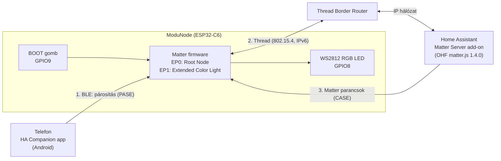

# ModuNode – Matter over Thread: első működő node Home Assistantban

**Állapot:** 2026-10-09 · checkpoint: `cp-02-matter-thread-ha`

## Röviden
Egy ESP32-C6 mikrovezérlőn futó **Matter** firmware **Thread** hálózaton keresztül csatlakozott az otthoni
**Home Assistant** (HA) rendszerhez. A board beépített RGB LED-je a HA-ból kapcsolható, a fényereje és a színe is
állítható. A teljes lánc működik: Bluetooth-os párosítás → Thread háló → border router → Home Assistant. Ez
a ModuNode platform végleges kommunikációs alapja. A következő lépés a gyári „lámpa” helyett a saját
ModuNode funkciók (relé, ajtóérzékelő) beépítése.

---

## 1. Hol tart a projekt
| Mérföldkő | Tartalom | Állapot |
|---|---|---|
| `cp-01-esphome-demo` | ESPHome vezérlő demó a C6-on: relé, ajtóérzékelő, Kézi/Automata mód, webes felület | ✅ hardveren tesztelve |
| `cp-02-matter-thread-ha` | Matter over Thread, párosítás Home Assistantba, LED vezérlés | ✅ hardveren tesztelve (ez a dokumentum) |
| következő | Saját Matter endpointok: relé (`on_off_plugin_unit`) + ajtó (`contact_sensor`), helyi logikával | 🔜 |

**Miért Matter over Thread a végleges irány?**
- **Matter:** gyártófüggetlen szabvány (CSA). Ugyanaz az eszköz működik Home Assistanttal, Google Home-mal,
  Apple Home-mal és Amazon Alexával. Egyszerre több vezérlőhöz is csatlakozhat (multi-admin), ezt ki is
  próbáltuk: Google és HA egyszerre.
- **Thread:** kis fogyasztású, önszerveződő mesh hálózat (IEEE 802.15.4, 2,4 GHz). Nincs benne WiFi jelszó,
  és minden hálózati tápos node routerként továbbítja a többiek forgalmát. Így a háló a node-ok számával
  együtt erősödik.
- **Az ESPHome szerepe:** a gyors prototípushoz és a bemutatóhoz volt jó (`cp-01`). Saját protokollt használ, és
  szorosan a HA-hoz kötődik, ezért a végleges, szabványos megoldás a Matter.
- **ESP32-C6:** egy chipen van WiFi 6, BLE 5.3 és 802.15.4 (Thread) rádió. A gyártó (Espressif) karbantartott,
  hivatalos Matter SDK-t ad hozzá (ESP-Matter).

---

## 2. Architektúra

- **Párosításkor** a telefon Bluetooth-on (BLE) éri el a node-ot, és átadja neki a Thread hálózat adatait.
- **Utána** minden kommunikáció IPv6-on megy, Threaden keresztül. A border router köti össze a Thread hálót az
  otthoni IP hálózattal. A BLE kapcsolat a párosítás után lezárul.

---

## 3. A firmware
| | |
|---|---|
| Alap | Espressif `esp-matter` `release/v1.6`, `examples/managed_component_light` (commit b90027f) |
| Keretrendszer | ESP-IDF **v5.5.5**, `espressif/esp_matter` **1.5.1** (IDF Component Manager, `dependencies.lock` rögzíti) |
| Hálózat | Thread **FTD** (Full Thread Device): routerré tud előlépni, és a log szerint elő is lépett |
| Adatmodell | Endpoint 0: Root Node (kötelező) · Endpoint 1: **Extended Color Light** (OnOff, LevelControl, ColorControl stb.) |
| Hardver | Beépített WS2812 RGB LED (GPIO8) · BOOT gomb (GPIO9): rövid nyomás = ki/be, 5 s = gyári visszaállítás |
| Méret | Az alkalmazás 1,73 MB. Két OTA partíció van, mindkettő 1,875 MB; a szabad hely 10% |
| Flash | 4 MB: bootloader, NVS, 2× OTA app, gyári adatok (`fctry`), tanúsítvány partíció |
| RAM | Induláskor ~309 KiB heap (+15 KiB RTC RAM) áll rendelkezésre (a C6-on nincs PSRAM) |

**Saját módosítások a gyári példához képest (szándékosak):**
- Thread build a C6-ra, ugyanúgy, ahogy az Espressif saját CI-je fordítja (`sdkconfig.defaults.c6_thread`).
- A DevKit LED és gomb bekötése, és a projekt neve (`modunode_matter`).
- Kimaradt a titkosított OTA, mert nincs hozzá kulcs. A hiányzó közös fejléc (`common_macros.h`) pótolva lett.

**Párosító adatok (fejlesztői teszt értékek):** VID 0xFFF1 (teszt) / PID 0x8000, discriminator 3840,
passcode 20202021, QR: `MT:Y.K9042C00KA0648G00`, manuális kód: `3497-011-2332`. A QR-kódot a firmware által
hirdetett paraméterekből a Matter szabvány szerint újra kiszámoltam, és egyezett.

---

## 4. Mi történt a párosításkor (a soros logból)
A sikeres próbálkozás idővonala. Az idő a node bekapcsolásától számít, másodpercben.

| Idő | Esemény | Jelentés |
|---|---|---|
| 1,4 s | `CHIPoBLE advertising started` | A node BLE-n hirdeti, hogy párosítható |
| 18,1 s | `BLE GAP connection established` | A telefon csatlakozott |
| 19,0 s | PASE kész | A setup kód (passcode) stimmel, titkosított párosítási csatorna jött létre |
| 31,3 s | `AttestationRequest successful` | A node igazolta, hogy „valódi” Matter eszköz (DAC tanúsítvány) |
| 32,3 s | `Added new fabric at index: 0x1` | Megkapta az operatív tanúsítványát (NOC) a **Google** fabricben |
| 33,6 s | `Role detached -> child` | **Csatlakozott a Thread hálóra** |
| 34,7 s | BLE lezárva | Innentől csak Thread |
| 80,9 s | `Commissioning completed successfully` (Google, VendorId 0x6006) | Első vezérlő kész |
| 85,8 s | `Received command to open commissioning window` | Az Android új párosítási ablakot nyit a HA-nak |
| 90,1 s | Attesztáció (HA) | A HA is ellenőrzi a tanúsítványt, most már elfogadja |
| 91,2 s | `Added new fabric at index: 0x2` | **Home Assistant** fabric (VendorId 0x134B) |
| 93,2 s | `Commissioning completed successfully` | **Kész: a node két vezérlőhöz tartozik** |
| 214 s- | `MOVE_TO_LEVEL_WITH_ON_OFF`, OnOff, szín | A HA-ból érkező vezérlő parancsok |

A Google lépés hosszú (kb. 46 s) a telefon és a Google felhő oldalán telt el. A HA lépés kb. 8 s alatt lement.

---

## 5. Problémák és megoldásaik
| # | Probléma | Ok | Megoldás |
|---|---|---|---|
| 1 | Az első build konfigurálási hibával leállt | A gyári példa egy közös fejlécmappára hivatkozik (`common/utils`), ami a projektből kimaradt | `common_macros.h` átmásolva az upstreamből, változatlanul |
| 2 | A telefon elakadt a „Generating Matter credentials” lépésnél, a node-hoz el sem jutott | A Google Home Developer Console-ban a teszt eszköz (VID/PID) nem volt elmentve | Integráció kitöltése és mentése („Ready to test”) |
| 3 | A Google párosítás után a HA 4-szer egymás után elutasította a node-ot („error code 1”) | A firmware a Matter **teszt** tanúsítványláncával (Test PAA) jelentkezik, a HA Matter Server pedig alapból csak a CSA éles listáján (DCL) szereplő gyártókat fogadja el | HA Matter Server add-on: **„Enable test-net DCL usage”** bekapcsolva. Ezt a log mintázata árulta el: attesztáció → a HA azonnal megszakít (`ArmFailSafe(0)`) |
| 4 | A soros log figyelése újraindította a node-ot | A beépített USB-soros port megnyitásakor a vezérlőjelek reset-parancsnak számítanak | Megkerülés: előbb a log, és csak a nyitott párosítási ablak után a telefon. Végleges javítás: teendő |

**Tanulság:** a hibák nem a firmware-ben voltak. A firmware minden lépésben helyesen válaszolt. A
környezetben kellett két dolgot beállítani: a fejlesztői tanúsítványok elfogadását a Google és a HA oldalán.

---

## 6. Mit teszteltünk, és mit még nem
**Tesztelve (2026-10-09, egy darab C6 boardon):**
- Párosítás Android telefonról a HA appal, Thread hálóra, két fabricbe (Google + HA)
- A HA-ból: **ki/be kapcsolás, fényerő, szín** → a board LED-je követi (szemmel ellenőrizve és a logban)
- A node Thread routerré lépett elő (`child -> router`)
- Gyári visszaállítás (BOOT 5 s) → tiszta újrapárosítás

**Még nem tesztelve / nem mérve:**
- Hosszú távú stabilitás (órák, napok), újracsatlakozás áramszünet vagy border router újraindítás után
- Késleltetés (parancstól a LED-ig) és fogyasztás számszerűen
- A BOOT gomb rövid nyomásának visszajelzése a HA-ban
- Több node egy hálóban, iPhone-os párosítás, OTA frissítés

---

## 7. Biztonság
- **Párosítás (PASE):** a setup kódból jelszó-alapú kulcscsere (SPAKE2+). Aki nem ismeri a kódot, nem tud párosítani.
- **Eszköz-hitelesítés (attesztáció):** a node egy tanúsítványlánccal igazolja magát: DAC → PAI → PAA. Ezt a
  vezérlő a CSA nyilvános listájához (DCL) méri. **Most teszt tanúsítványok vannak benne**, ezért kellett a HA-ban
  a teszt lista. Fejlesztéshez ez a szabványos út.
- **Üzemi kommunikáció (CASE):** tanúsítvány-alapú, titkosított munkamenetek. Minden vezérlő (fabric) saját
  operatív tanúsítványt ad a node-nak, a jogosultságokat hozzáférés-listák (ACL) szabályozzák.
- **Thread:** a háló saját hálózati kulccsal titkosít. Ezt a node párosításkor kapja meg.
- **Termékhez még hiányozna:** saját, CSA-ban regisztrált gyártóazonosító és tanúsítványok, egyedi passcode
  eszközönként, secure boot és flash titkosítás. Ezek most szándékosan nincsenek bekapcsolva
  (fejlesztői prototípus).

---

## 8. Várható kérdések és válaszok
**Miért nem WiFi-n megy a Matter, ha a C6 tud WiFi-t?**
A Thread kisebb fogyasztású, mesh, és a node-oknak nem kell WiFi jelszó. Az otthoni hálózatban már volt Thread
border router. A firmware egy beállítással WiFi-re is fordítható, mert a Matter réteg ugyanaz.

**Mi a border router, és muszáj-e?**
Ez köti össze a Thread hálót az IP hálózattal (ahol a HA fut). Matter over Threadhez kell legalább egy. Ilyen
lehet egy HA-hoz csatlakoztatott Thread rádió vagy egy okos hangszóró/hub.

**Miért van a node a Google-nél is, ha HA-ba párosítottunk?**
Androidon a párosítást a Google Play szolgáltatások végzik. Először a saját fabricjükbe veszik fel az eszközt,
aztán megosztják a HA-val. Ez a Matter multi-admin képessége. A Google kapcsolat törölhető, a HA-é megmarad.

**Mi történik, ha leáll a HA vagy az internet?**
Internet nem kell: minden helyben, a lakás hálózatán megy. Ha a HA leáll, a node tovább működik, és a gombbal
helyben vezérelhető. A ModuNode tervben a helyi logika (pl. ajtó → relé) a node-on fut, nem a HA-ban (ezt az
ESPHome demó már mutatja). Ha a border router esik ki, a Thread háló belül megmarad, de a HA nem éri el a node-ot.

**Mennyire saját munka ez, és mennyi a gyári példa?**
A `cp-02` szándékosan a gyári példára épül: azt igazolja, hogy a teljes lánc (hardver, eszközlánc, Thread,
HA, tanúsítványok) működik. A saját rész ebben a fázisban:
- a C6/Thread konfiguráció és a projekt környezet;
- a hibák felderítése a protokoll-logokból;
- a dokumentált, reprodukálható folyamat.

A saját funkcionalitás (relé, ajtóérzékelő, helyi logika) a következő mérföldkő.

**Mennyi erőforrás marad a saját funkciókra?**
- **Flash:** az app 1,73 MB, az 1,875 MB-os slot 90%-a. Kevés, mert az OTA miatt két slot kell. A
  partíciós tábla átméretezhető, és a gyári lámpa kódja (szín, effektek) helyére kerül a sokkal egyszerűbb relé
  és ajtó logika.
- **RAM:** induláskor ~309 KiB heap. A futás közbeni minimumot még nem mértük, ez a következő fázis feladata.

**Biztonságos-e a teszt tanúsítvány?**
Fejlesztéshez igen, és a szabvány pontosan erre tartja fenn (VID 0xFFF1–0xFFF4). Termékbe nem kerülhet: ott
saját, CSA által aláírt lánc kell. A HA-ban a „test-net DCL” csak a teszt gyökértanúsítványokat engedi pluszban,
az éles ellenőrzést nem kapcsolja ki.

**Lehet-e több node-ot ugyanígy?**
Igen, de minden node-nak egyedi discriminator és passcode kell. A teszt firmware-ben ezek fixek. Ezt a gyári
adatpartíció (`fctry`) generálásával lehet megoldani (Espressif `esp-matter-mfg-tool`).

**Hogyan frissíthető a firmware?**
Most USB-n. A partíciós tábla és a firmware már támogatja a Matter OTA-t (két app slot, OTA Requestor), de ehhez
OTA Provider kell a hálózaton. Ez még nincs kipróbálva.

**Mi a különbség a Matter és a Zigbee között? A C6 tud Zigbee-t is.**
Mindkettő 802.15.4 rádiót használ. A Zigbee saját alkalmazási réteggel és saját hálóval (koordinátorral) dolgozik,
nem IP-alapú. A Thread IPv6-ot visz, a Matter pedig egységes, gyártófüggetlen alkalmazási réteg Threaden és
WiFi-n egyaránt. Ez a ModuNode moduláris, bővíthető céljához jobban illik.

**Reprodukálható-e a build?**
Igen, a pontos verziók rögzítve vannak: ESP-IDF v5.5.5 és `dependencies.lock` az összes komponens verziójával és
hash-ével. A lépések a `firmware/matter-c6/README.md`-ben és a `CHECKPOINTS.md`-ben vannak; a teljes
folyamat egy `mt.sh` scriptből fut.

---

## 9. Következő lépések
1. **Saját endpointok:** `on_off_plugin_unit` → Relé 1 (GPIO18) és `contact_sensor` → ajtó (GPIO19, AH1911
   Hall-szenzor). A gyári lámpa helyett; az RGB LED állapotjelző marad.
2. **Helyi logika a node-on:** ajtó nyit → relé be, késleltetett kikapcsolás (az ESPHome demó logikája Matterben).
3. **Mérések:** heap minimum, kapcsolási késleltetés, újracsatlakozás áramszünet után.
4. **Breadboard áramkör** a relé- és érzékelő oldalhoz. Utána a NYÁK tervezés (I/O expander: TCA9554, mert a
   PCF8574 bekapcsoláskor meghúzná a reléket).
5. Fejlesztői eszköz javítás: a soros log ne indítsa újra a node-ot.

---

## 10. Fogalomtár
| Fogalom | Jelentés |
|---|---|
| **Matter** | Gyártófüggetlen okosotthon alkalmazási szabvány (CSA), IP alapon |
| **Thread** | Kis fogyasztású IPv6 mesh hálózat 802.15.4 rádión |
| **Border Router** | A Thread hálót és az IP hálózatot összekötő eszköz |
| **Fabric** | Egy vezérlő „világa” (pl. HA, Google); egy eszköz több fabricben is lehet |
| **Endpoint / Cluster** | Az eszköz funkcionális egysége / egy funkció szabványos interfésze (pl. OnOff) |
| **Commissioning** | Párosítás: az eszköz felvétele egy fabricbe |
| **PASE / CASE** | Párosítási (setup kódos) / üzemi (tanúsítványos) titkosított munkamenet |
| **DAC / PAI / PAA** | Eszköz-, köztes és gyökér-tanúsítvány az eszköz eredetiségének igazolására |
| **DCL** | Distributed Compliance Ledger: a CSA nyilvános listája a megbízható gyártókról és tanúsítványokról |
| **FTD** | Full Thread Device: routerként is működni képes Thread eszköz |

## Visszaállítás
`git checkout cp-02-matter-thread-ha`, utána a `firmware/matter-c6/README.md` szerint: `bash mt.sh setup` → `build` →
`erase` → `flash`. A HA-ban kell a test-net DCL beállítás, Androidon a Developer Console integráció.
